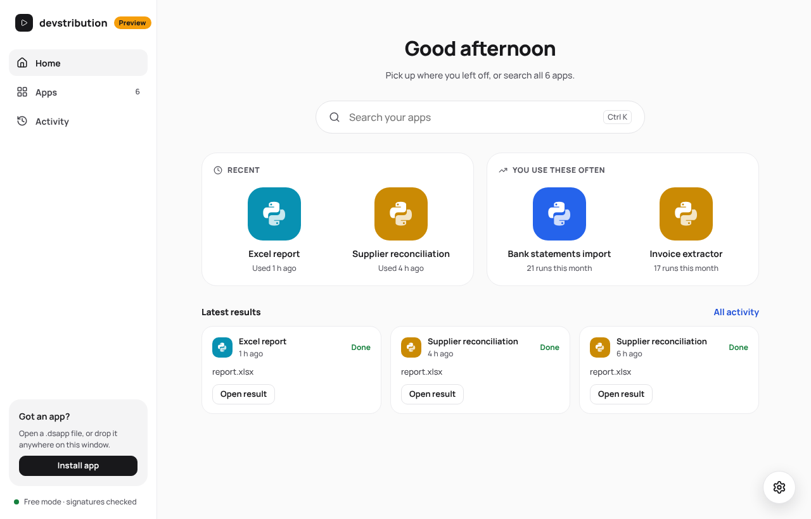
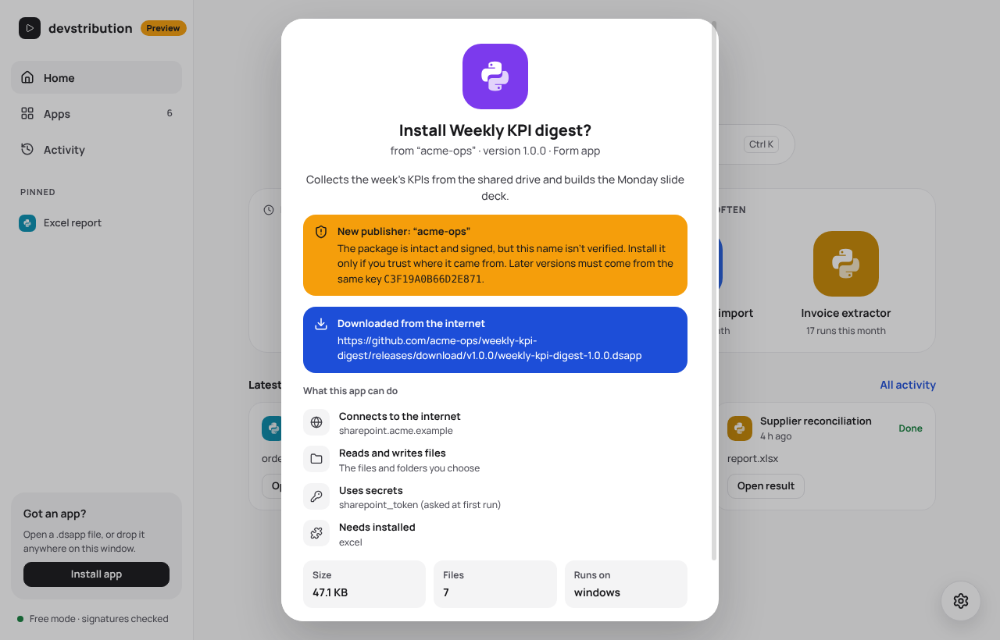
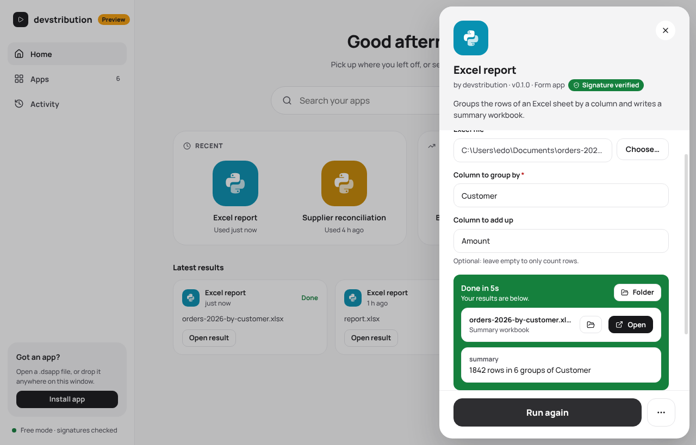
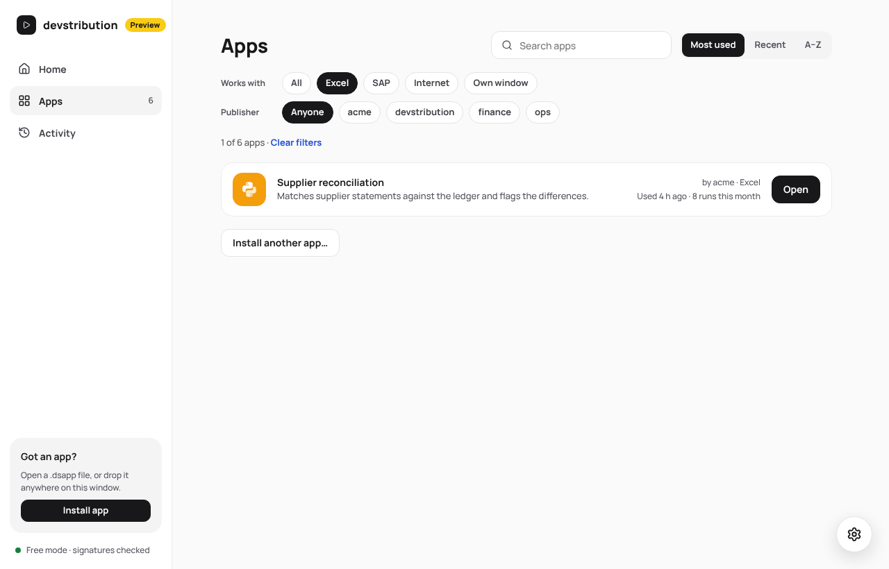
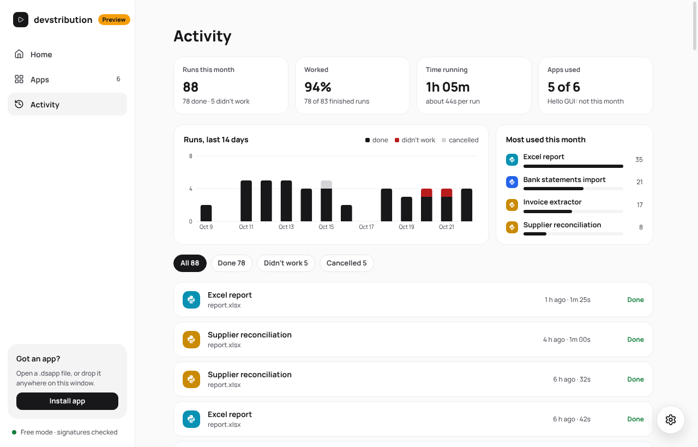

# devstribution

Writing code has become much faster, especially with coding agents. Sharing it with colleagues
is often still the hard part: Python has to be installed, installers have to be built and signed,
and IT, rightly, wants to know what runs on company PCs. **devstribution** is an attempt to make
this easier. Python apps (tools, automations, proofs of concept) are shared as signed packages,
and a single signed launcher checks, installs and runs them. Each app is trusted according to who
published it, and the launcher checks that what you run is exactly what that publisher signed.

**Status: early proof of concept (pre-alpha).** It isn't ready for everyday use yet: the launcher
is not code-signed, and some Windows-specific parts still need testing on real PCs. The design is
in [docs/plan.md](docs/plan.md); the launcher's look (palette, type, components) in
[docs/design.md](docs/design.md). What the platform protects against, and what it doesn't, is in
[docs/security.md](docs/security.md). For IT departments: [docs/managed-mode.md](docs/managed-mode.md)
explains how to allow only the authors you approve.



## What exists today

A proof of concept that works end to end; what has been verified so far, and on which systems, is
in [docs/status_quo.md](docs/status_quo.md):

| Part | Where |
|---|---|
| Launcher (Tauri): home, apps with filters, activity dashboard, install confirmation, app panel, settings; light and dark themes, a choice of accent colours, colour-blind safe status colours | `launcher/` |
| Install store, uv environments, supervised runs, history, secrets | `crates/devstribution-host` |
| Package format: manifest, `FILES.sha256`, minisign signatures, safe extraction, wheels-only check | `crates/devstribution-core` |
| Developer CLI: `init`, `dev`, `pack`, `keygen`, `verify` | `crates/devstribution-cli` |
| Python runner (stdlib only) and its JSON protocol | `runner/` |
| Example apps: `excel-report` (form), `hello-gui` (gui) | `examples/` |

| Install confirmation | Running an app |
|---|---|
|  |  |
| **Apps** | **Activity** |
|  |  |

## Try it

You need [Rust](https://rustup.rs) and [uv](https://docs.astral.sh/uv/).

```sh
cargo install --path crates/devstribution-cli

devstribution init my-tool --id yourname/my-tool      # a form app that passes every check
devstribution dev my-tool -i name=Ada                # run it as the launcher would
devstribution keygen --namespace yourname            # once: your publisher key
devstribution pack my-tool                           # check, sign -> my-tool/dist/my-tool-0.1.0.dsapp
devstribution verify my-tool/dist/my-tool-0.1.0.dsapp --key <keys folder>/yourname.pub
```

An app is an ordinary Python folder: `pyproject.toml` with a `[tool.devstribution]` section,
a `uv.lock`, and the code. See `examples/` and the `AGENTS.md` that `init` writes for coding
agents.

Run the launcher (needs Node 22+; on Linux also the WebKitGTK libraries listed in the CI workflow):

```sh
cd launcher
npm ci
npm run sidecar        # puts your uv next to the launcher
npx tauri dev
```

`npm run dev` alone serves the UI in a browser with demo data.

## Development

```sh
cargo test                                            # core, host (install and run with uv), CLI
python3 -m unittest discover -s runner/tests          # runner protocol and code checks
```

## License

Dual-licensed under [MIT](LICENSE-MIT) or [Apache-2.0](LICENSE-APACHE), at your option.
Contributing: see [CONTRIBUTING.md](CONTRIBUTING.md). Security issues: see [SECURITY.md](SECURITY.md).
