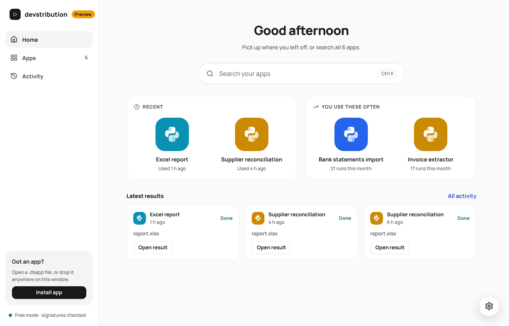
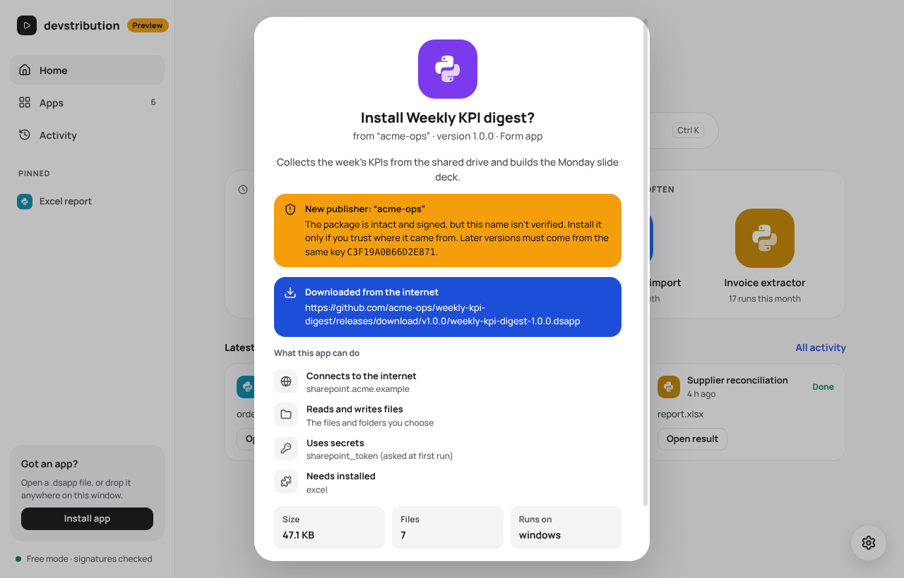
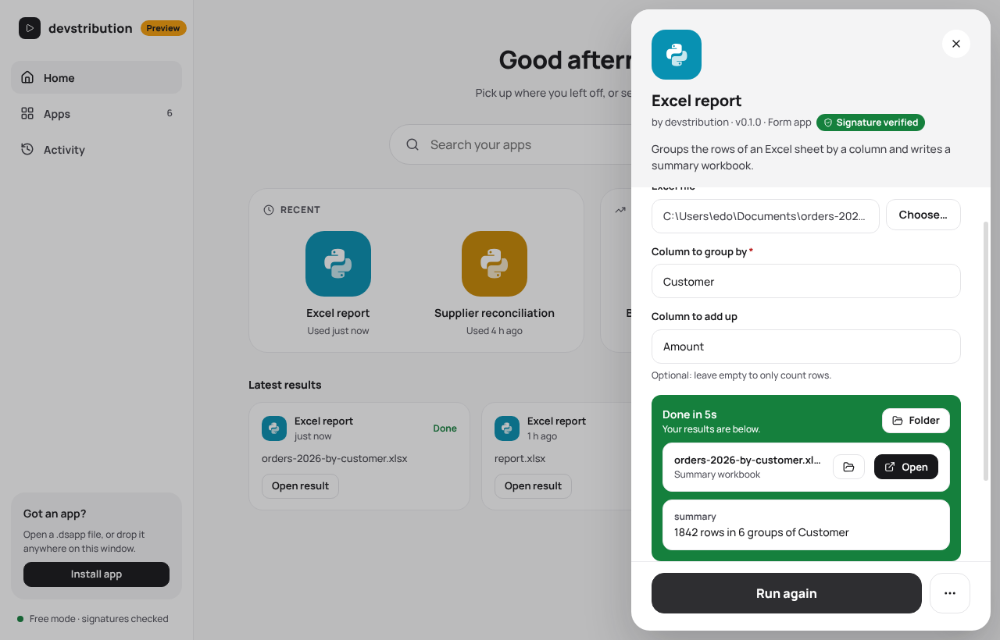
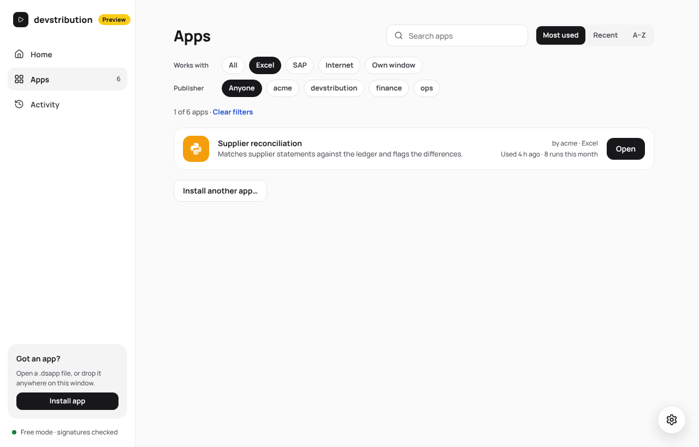
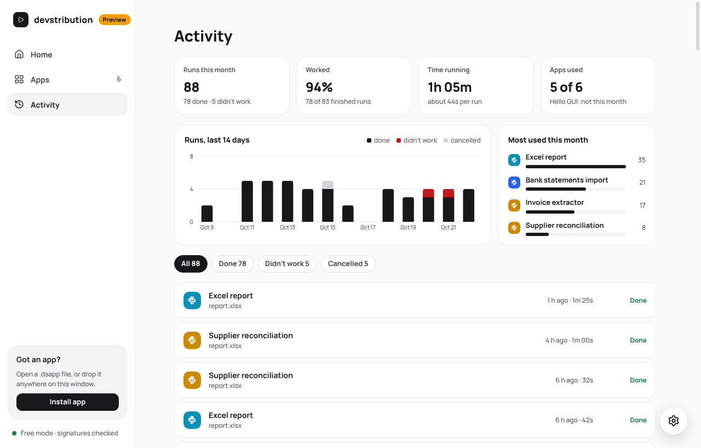

# devstribution

**Your coding agent wrote a Python tool in an hour. devstribution gets it onto your colleagues'
PCs the same afternoon: signed, checked, no admin rights, and IT can see what runs.**

You pack the tool into one signed `.dsapp` file. Colleagues install the devstribution launcher
once, then double-click any `.dsapp`: the launcher checks who signed it and that nothing was
changed, scans its code, sets up its own Python with [uv](https://docs.astral.sh/uv/), and runs
it, with a form for its inputs instead of a terminal. Updates must come from the same publisher. A
runtime guard stops an app that does what it did not declare, and IT can limit installs to the
authors it approves and export a bill of materials (SBOM) of every app.

<!-- P13: a short GIF here, from a double-clicked .dsapp to a finished run. -->


### Compared with what you would do today

| | Recipient needs | Signed and checked | Updates | What IT sees |
|---|---|---|---|---|
| Email a `.py` | Python and the right packages | No | Email it again | Nothing |
| [PyInstaller](https://pyinstaller.org) or [Nuitka](https://nuitka.net) | Nothing: one `.exe` per app, Python inside | Only with your own code-signing certificate; unsigned executables often trip antivirus | Build and send a new `.exe` | An unknown `.exe` |
| [Briefcase](https://briefcase.readthedocs.io) | An installer per app | Only with your own certificate | A new installer | An installer per app |
| **devstribution** | The launcher, installed once, per user | Every package is signed with its author's key, checked and its code scanned before it installs | A newer `.dsapp`, accepted only from the same publisher; IT can point every PC at a shared folder | On each PC, nothing sent anywhere: who published each app, what it may do, what the guard stopped, and its SBOM |

**Status: early pre-releases (0.x), Windows only.** Good for trying out, not yet for everyday use:
the launcher itself is not code-signed yet (Windows SmartScreen warns when the installer starts),
and a locked-down company PC and managed mode still need testing on real PCs. The
[roadmap](docs/roadmap.md) has what comes before a signed 1.0. What the platform protects against,
and what it doesn't: [docs/security.md](docs/security.md). For IT departments:
[docs/managed-mode.md](docs/managed-mode.md). The design: [docs/plan.md](docs/plan.md) and
[docs/design.md](docs/design.md).

## Try it

From the [latest release](https://github.com/Devstribution/devstribution/releases):

1. **Run `devstribution_<version>_x64-setup.exe`.** It installs for your Windows user, without admin
   rights. SmartScreen warns because it is not code-signed yet: "More info", then "Run anyway".
2. **Unzip `devstribution-cli-<version>-x86_64-pc-windows-msvc.zip`** (macOS and Linux builds are
   there too) and install [uv](https://docs.astral.sh/uv/getting-started/installation/). Then:

```sh
devstribution init my-tool --id yourname/my-tool      # a form app that passes every check
devstribution dev my-tool -i name=Ada                # run it as the launcher would
devstribution keygen --namespace yourname            # once: your publisher key
devstribution pack my-tool                           # check, sign -> my-tool/dist/my-tool-0.1.0.dsapp
```

3. **Double-click `my-tool-0.1.0.dsapp`.** That file is what you send to colleagues.

An app is an ordinary Python folder: `pyproject.toml` with a `[tool.devstribution]` section, a
`uv.lock`, and the code. Point your coding agent at the `AGENTS.md` that `init` writes. The guide
from `init` to a delivered `.dsapp`, including releasing from GitHub Actions with no key on your
PC, is [docs/authors.md](docs/authors.md); see also `examples/`.

To check that a download came from this repository's release workflow, with the
[GitHub CLI](https://cli.github.com), in the folder you downloaded to:

```sh
gh attestation verify SHA256SUMS.txt --repo Devstribution/devstribution
sha256sum --check --ignore-missing SHA256SUMS.txt
```

## What exists today

A proof of concept that works end to end; what has been verified so far, and on which systems, is
in [docs/report.md](docs/report.md), and what comes next in [docs/roadmap.md](docs/roadmap.md). To
work on devstribution itself, start with [CONTRIBUTING.md](CONTRIBUTING.md).

| Part | Where |
|---|---|
| Launcher (Tauri): home, apps with filters, activity dashboard, install confirmation, app panel, a Security page (checks, runtime guard log, bills of materials), settings; light and dark themes, a choice of accent colours, colour-blind safe status colours | `launcher/` |
| Install store, uv environments, supervised runs, history, secrets | `crates/devstribution-host` |
| Package format: manifest, `FILES.sha256`, minisign signatures, safe extraction, wheels-only check | `crates/devstribution-core` |
| Developer CLI: `init`, `dev`, `pack`, `keygen`, `verify` | `crates/devstribution-cli` |
| Python runner (stdlib only) and its JSON protocol | `runner/` |
| Example apps: `excel-report` (form), `hello-gui` (gui) | `examples/` |

| Install confirmation | Running an app |
|---|---|
|  |  |
| **Apps** | **Activity** |
|  |  |

## Development

You need [Rust](https://rustup.rs) and [uv](https://docs.astral.sh/uv/). The CLI from source:

```sh
cargo install --path crates/devstribution-cli
```

The launcher (needs Node 22+; on Linux also the WebKitGTK libraries listed in the CI workflow):

```sh
cd launcher
npm ci
npm run sidecar        # puts your uv next to the launcher
npx tauri dev
```

`npm run dev` alone serves the UI in a browser with demo data. Tests:

```sh
cargo test                                            # core, host (install and run with uv), CLI
python3 -m unittest discover -s runner/tests          # runner protocol and code checks
```

## License

Dual-licensed under [MIT](LICENSE-MIT) or [Apache-2.0](LICENSE-APACHE), at your option.
Contributing: see [CONTRIBUTING.md](CONTRIBUTING.md). Security issues: see [SECURITY.md](SECURITY.md).

## Code signing policy

Releases are not code-signed yet. The policy signed releases will follow (who approves them,
what gets signed, what the launcher sends over the network) is in
[docs/code-signing-policy.md](docs/code-signing-policy.md).
