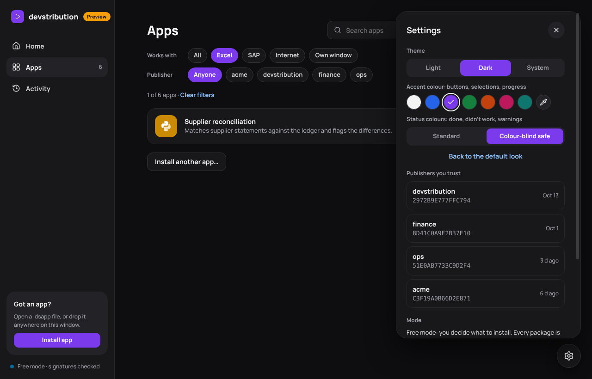

# Design language

How the launcher looks and why. The stylesheet is [`launcher/src/style.css`](../launcher/src/style.css).
Every colour, size and radius in it comes from a token at the top of that file. This page and those
tokens describe the same thing, so change them together.

## Principles

1. **Apps carry the colour; the launcher stays neutral.** The interface is greys plus one accent.
   The only colourful things on screen by default are the app tiles.
2. **Filled, never tinted.** Anything that signals something (a banner, a status box, a tag, a toast,
   the selected option) is a solid fill with its own text colour. There are no pale washes, no
   transparent overlays on content, and no glows.
3. **Selected means filled with the accent.** Chips, segmented controls, switches, progress bars,
   install steps and the brand mark all use the accent. Nothing else does.
4. **Shadows only for what floats.** The panel, dialogs, popovers, menus, toasts and the settings
   button cast a shadow. Cards, rows, tiles and inputs sit flat on the page with a 1px border.
5. **Plain words.** Say "Done", "Didn't work", "Cancelled", never "Succeeded" or "Exit code 1".
   Use sentence case everywhere, no exclamation marks, and say what happens next.
6. **No inline visual styles in the views.** Views pick classes from `style.css`. Only computed
   values (a bar's width, a user-picked colour) go into `style=`.

## Logo

An ink square with rounded corners and a white play triangle: the same mark as the sidebar's
brand square, with no gradient. The source is `launcher/src/logo.svg`. After changing it,
regenerate the app icons with `npx tauri icon src/logo.svg` (from `launcher/`), then delete the
`android/` and `ios/` folders it also writes.

## Palette

Light and dark themes share the same semantic token names; only their values change. The raw
colours (`--zinc-*`, `--blue-600`, …) are primitives, and components never use them directly.

### Neutrals (zinc)

| Token | Light | Dark | Used for |
|---|---|---|---|
| `--bg` | `#fafafa` | `#0e0e10` | Page behind everything |
| `--surface` | `#ffffff` | `#18181b` | Cards, sidebar, panel, dialogs |
| `--surface-2` | `#f4f4f5` | `#232327` | Neutral fills: nav hover, segmented track, facts, panel head |
| `--border` | `#ececef` | `#27272a` | Card and row borders |
| `--border-strong` | `#e4e4e7` | `#34343a` | Buttons, inputs, chips |
| `--text` | `#18181b` | `#f4f4f5` | Main text |
| `--text-2` | `#3f3f46` | `#d4d4d8` | Secondary text |
| `--muted` | `#52525b` | `#a1a1aa` | Hints, meta, labels |
| `--faint` | `#a1a1aa` | `#71717a` | Hover borders, dashed outlines |
| `--link` | `#1d4ed8` | `#93c5fd` | Text links and the keyboard focus ring |

### Accent

The default accent is **Ink**: black on light, white on dark. People can change it in
Settings (see below).

| Preset | Colour | Text on it |
|---|---|---|
| Ink (default) | `#18181b` / `#f4f4f5` | white / black |
| Blue | `#2563eb` | white |
| Violet | `#7c3aed` | white |
| Green | `#15803d` | white |
| Orange | `#c2410c` | white |
| Pink | `#be185d` | white |
| Teal | `#0f766e` | white |

Every preset gives white text a contrast of at least 4.5:1. A custom accent gets black or white
text, whichever contrasts more (`textOn` in `look.ts`).

### Status

Each status has three tokens:
- the fill (`--success`);
- the text that goes on the fill (`--on-success`);
- the colour for status words on a plain surface (`--success-text`, as in "Done" in a list).

| Status | Fill | Text on fill | Words on surface (light / dark) | Means |
|---|---|---|---|---|
| success | `#15803d` | white | `#15803d` / `#4ade80` | Done, signature verified |
| warning | `#facc15` | black | `#b45309` / `#fbbf24` | New publisher, preview build |
| danger | `#b91c1c` (dark `#dc2626`) | white | `#b91c1c` / `#f87171` | Didn't work, can't install |
| info | `#1d4ed8` (dark `#2563eb`) | white | `#1d4ed8` / `#60a5fa` | Downloaded from the internet |

**Colour-blind safe** (an option in Settings) swaps in colours that people with red-green colour
blindness can tell apart:
- success becomes blue `#0369a1`;
- danger becomes orange `#c2410c`;
- info becomes grey, so it doesn't clash with the new blue.

### App tiles

`--app-1` to `--app-8` are the tile colours for apps without their own icon. Each app always gets
the same one, picked by hashing its id:

`#2563eb` `#7c3aed` `#0e9f6e` `#ea580c` `#db2777` `#0891b2` `#4f46e5` `#f59e0b`

They always carry white text. The launcher's chrome never uses them.

### Charts

In the runs chart:
- "done" bars use the accent;
- "didn't work" bars use the danger fill;
- "cancelled" bars use a neutral grey.

So the chart follows both Settings choices automatically.

## Type

**Manrope** (variable), bundled with the app, so it looks the same on every computer. If it fails
to load, Segoe UI or the system font is used instead. Code and keys use the system monospace font.

| Token | Size | Use |
|---|---|---|
| `--fs-micro` | 11 | Capitalised section labels, chart axes |
| `--fs-xs` | 12 | Hints, meta lines, tags |
| `--fs-sm` | 13 | Secondary text, small buttons, banners |
| `--fs-base` | 14 | Body |
| `--fs-md` | 16 | Big search, big buttons, section titles |
| `--fs-lg` | 18 | Popover titles |
| `--fs-xl` | 20 | Panel and dialog titles |
| `--fs-2xl` | 24 | Dashboard numbers |
| `--fs-3xl` | 28 | Page titles |
| `--fs-4xl` | 32 | The greeting |

Weights:
- 500 (`--fw-regular`): body text.
- 600 (`--fw-semibold`): menu items, toasts.
- 700 (`--fw-bold`): labels, buttons.
- 800 (`--fw-heavy`): titles and numbers.

Titles get slightly negative letter spacing. Capitalised labels get wide spacing (0.06–0.08em).

## Shape and space

Corners get rounder as things get bigger:

| Token | Radius | Use |
|---|---|---|
| `--r-xs` | 6 | Keyboard keys |
| `--r-sm` | 10 | Small buttons, menu items |
| `--r-md` | 12 | Buttons, inputs, nav items, boxes inside a card |
| `--r-lg` | 16 | Banners, run rows, big buttons |
| `--r-xl` | 18 | Cards, app rows, KPIs |
| `--r-2xl` | 24 | Panel, popover, home shelves |
| `--r-3xl` | 28 | Dialogs |
| `--r-pill` | 999 | Chips, tags, toasts, search |

App icons are squircles at about 29% of their size: 14px on a 48px icon, 24px on an 84px one.

Spacing follows a 4px grid (`--sp-1` = 4 up to `--sp-10` = 40). Inner padding may use 2px
half-steps (10, 14, 18) when the 4px step looks cramped.

## Components

| Component | Look |
|---|---|
| Primary button | Accent fill, accent's text colour. One per view, for the main action. |
| Secondary button | Surface fill, strong border. Ghost: no border until hover. |
| Chip | Pill with a border. Selected: accent fill. |
| Segmented control | Grey track. Selected option: accent fill. |
| Tag | Small solid pill: neutral, or a status fill when it means a status. |
| Banner | Solid status fill, icon on the left, bold first line. |
| Run state | Running or cancelled: neutral box. Done: success fill. Didn't work: danger fill. Outputs and the error message sit on white cards inside. |
| Toast | Solid pill at the bottom centre. Information: inverse (dark on light, light on dark). Results: their status fill. |
| Log | Always dark, monospace, whatever the theme. |
| Panel | Slides in from the right. Neutral grey head with the app's icon, form in the middle, the main action fixed at the bottom. |

## What people can change (Settings → Appearance)

- **Theme:** Light, Dark or System.
- **Accent colour:** the presets above, or any colour from a picker.
- **Status colours:** Standard or Colour-blind safe.
- **Back to the default look** resets all three.

The choices are saved per user in the launcher window's local storage, under `look`. `look.ts`
applies them by setting attributes on the page root:
- `data-theme`, `data-accent` and `data-status`, which `style.css` matches;
- for a custom accent, `--accent` and `--on-accent` set directly on the root.

## Adding or changing a colour

1. Add the raw colour as a primitive in section 1a of `style.css`, if it's new.
2. Point a semantic token at it, in both the light and the dark block.
3. Use the semantic token in components. Never use a hex value or a primitive there.
4. Check text on any new fill reaches 4.5:1 contrast in both themes.
5. Update the tables on this page.
