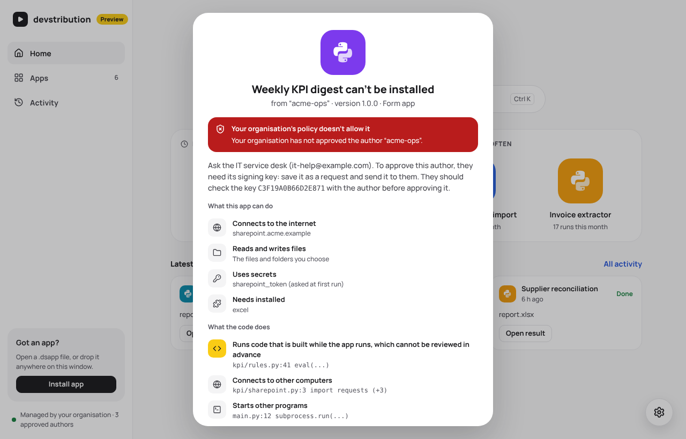

# Managed mode: a guide for IT

Managed mode lets an IT department decide which authors' apps devstribution installs and runs on
the company's PCs. It works with tools IT already has: a registry key pushed through Group
Policy or Intune, and files on a network share. No devstribution server is involved.

**Status: first version, Windows only, not yet tested on a managed PC.** The behaviour below is
covered by automated tests. Reading the real registry and checking file permissions on a real
network share have only been type-checked so far. Please try it on a test machine first.

## What changes for users

| | Free mode (no policy) | Managed mode |
|---|---|---|
| Who decides what installs | The user, with warnings | The policy: only approved authors |
| An unknown author | "New publisher" warning, then the user decides | Refused, with who to ask and a request file to send |
| Code the scan flags as malware-like | Red warning, "Install anyway" | Refused (or left to the user, if the policy says so) |
| An app the guard stopped | The user may let it run past that rule | Only IT decides (unless the policy lets users) |
| Installed apps from authors no longer approved | Run | Do not run |

The launcher's sidebar shows "Managed by your organisation · N approved authors". Settings
lists the policy, its source and the approved authors with their key fingerprints.



## Turning it on

Managed mode is on when this registry key exists:

```
HKEY_LOCAL_MACHINE\SOFTWARE\Policies\devstribution
```

Users cannot write under `HKLM`, so they cannot switch it off. All values are optional; an
empty key approves no one.

| Value | Type | Meaning |
|---|---|---|
| `PolicyFile` | REG_SZ | Full path of a TOML policy file (below), local or on a share |
| `TrustFolder` | REG_SZ | Full path of a folder of `.trust` files: every author in it is approved |
| `Authors` | REG_MULTI_SZ | Approved authors inline, one `<namespace> <public key>` per line |
| `Contact` | REG_SZ | Who users should ask, e.g. `the IT service desk (it-help@example.com)` |
| `DryRun` | REG_DWORD | `1`: refuse nothing, only log what would have been refused |
| `ScanDanger` | REG_SZ | `refuse` (default) or `ask`: packages whose code does things malware does |
| `UsersMayAllowGuardRules` | REG_DWORD | `1`: users may let a stopped app run past the rule that stopped it |
| `GuardReportOnly` | REG_MULTI_SZ | Runtime guard rules that only report, never stop, for every app |
| `MinLauncherVersion` | REG_SZ | Older launchers install and run nothing, and say why |
| `LauncherUpdates` | REG_DWORD | `0`: the launcher neither looks for nor installs its own updates (for IT that deploys it) |
| `UpdateFolder` | REG_SZ | Full path of a folder where you put new versions of apps: users are told of them (below) |

A registry value wins over the same setting in the policy file. The launcher reads the policy
when it starts: after a change, users restart devstribution (or sign in again).

### The policy file

The same settings in TOML, plus approved authors. Misspelt settings are refused, not ignored.

```toml
contact = "the IT service desk (it-help@example.com)"
dry_run = false
scan_danger = "refuse"
users_may_allow_guard_rules = false
guard_report_only = []
min_launcher_version = "0.2.0"
launcher_updates = true
update_folder = '\\fileserver\it\devstribution\apps'
trust_folder = '\\fileserver\it\devstribution\trust'
trust_files = ['\\fileserver\it\devstribution\extra\finance.trust']

[[authors]]                 # the .trust format, inline
namespace = "finance"
name = "Finance automation team"
[[authors.keys]]
key = "RWQ…"
```

### Files users must not be able to change

The policy file, the trust folder and every `.trust` file must be writable by administrators
only. The launcher checks this by asking Windows whether the current user could open them for
writing (nothing is written). A file or folder the user could change is **not used**, and
Settings says so.

### When something is wrong, it fails closed

A policy that cannot be read is not ignored: the launcher stays in managed mode and does not
approve the authors it could not read. Settings shows the problem, and the dot in the sidebar
turns amber. One exception keeps laptops working away from the office: when the approved
authors cannot be read at all (for example the share is out of reach), apps that were installed
under the policy keep running. Nothing new installs until the share is back. A file that was read
and is wrong does not count: it approves no one, and it does not keep a removed author's apps running.

## Approving an author

An author is a **namespace** (the part before `/` in app ids, such as `finance` in
`finance/invoice-check`) and the keys that sign for it. Approving it approves every app and
version in that namespace signed with one of those keys.

1. **Get the author's `.trust` file.** Either the author runs
   `devstribution trust export --namespace finance --name "Finance automation team"`, or a user
   whose install was refused clicks **Save a request for IT…** and sends you the file.
2. **Check the key with the author through another channel** (in person, a call, a ticket from
   their account): `devstribution trust show finance.trust` prints the fingerprint, which must
   match the one the author reads from their own key. A request file proves only what was in a
   package, not who made it.
3. **Put the file in the trust folder** (or list it in `trust_files`). Users get the change the
   next time devstribution starts.

To remove an author, remove its file. Its apps stop running at the next start.

## Delivering new versions of apps

Put new `.dsapp` files in the `UpdateFolder` (not in subfolders). When devstribution starts it
looks through that folder, and shows an update on any installed app with a newer version there.
Users review the changes and confirm, as with any update; no app updates by itself.

The folder gets no special trust: a package is offered only if it is signed by the app's
approved author and has a higher version, and it passes every check again when the user opens
it. So unlike the policy's files, this folder may be writable by others. Files that do not
qualify are ignored, and noted in `launcher.log`. If the folder cannot be read, Settings says so
when the user presses **Check now**. Users can also add folders of their own, in Settings.

## Rolling out

1. Set `DryRun = 1` with the authors you know of. Nothing is refused; users see a note on the
   install screen, and every would-be refusal is logged.
2. Collect the logs: `%LOCALAPPDATA%\dev.devstribution.launcher\data\state\policy.log`, one JSON
   line per decision (time, `refused` or `would_refuse`, `install` or `run`, app, version, key
   fingerprint, reasons).
3. Approve the authors you want, then set `DryRun = 0`.

## Checking it on a test PC

```powershell
# As administrator
New-Item -Path HKLM:\SOFTWARE\Policies\devstribution -Force
Set-ItemProperty HKLM:\SOFTWARE\Policies\devstribution -Name TrustFolder -Value 'C:\ProgramData\devstribution\trust'
Set-ItemProperty HKLM:\SOFTWARE\Policies\devstribution -Name Contact -Value 'the IT service desk'
New-Item -ItemType Directory C:\ProgramData\devstribution\trust -Force
# C:\ProgramData is writable by users by default: restrict the folder to administrators
icacls C:\ProgramData\devstribution\trust /inheritance:r /grant:r Administrators:F SYSTEM:F Users:RX
```

Then, as a normal user: start devstribution (the sidebar says "Managed by your organisation"),
try a package from an author not in the folder (refused, request file offered), copy that
author's `.trust` file into the folder as administrator, restart devstribution, and install
it. Remove the registry key to go back to free mode.

## Limits of this first version

- **The per-user launcher is installed in the user's own folder.** The policy protects users
  against packages they should not run; it cannot stop a user who sets out to get round it (for
  example by running a modified copy of the launcher). AppLocker or WDAC rules that allow only
  the signed launcher close that gap, and the per-machine mode in the [plan](plan.md) is the
  longer-term answer. See [`security.md`](security.md) for the full list of limits.
- **Users who are administrators** can write the policy's files when they run devstribution
  elevated (or with UAC off). The launcher then refuses those files, so nothing is approved:
  managed mode assumes standard user accounts.
- **Windows only.** On macOS and Linux the launcher is always in free mode.
- **Read at start.** A policy change applies when devstribution next starts.
- **Not yet:** an ADMX template for Group Policy, IT countersignatures, a revocation list,
  per-app approval (today an author is approved for all its apps), and the IT review kit
  ([`roadmap.md`](roadmap.md)).
